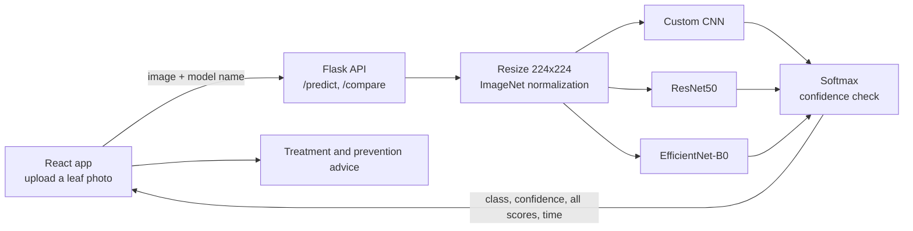

# PlantCare AI

**Plant disease detection from a single leaf photo.** Upload an image of a tomato, potato or bell pepper leaf, and PlantCare AI identifies the disease (or confirms the plant is healthy), shows how confident it is, and suggests treatment and prevention steps. Three deep learning models (a custom CNN, ResNet50 and EfficientNet-B0) can be run on the same image and compared side by side.

**Stack:** PyTorch, torchvision, Flask, React (Create React App), Recharts. Trained on an NVIDIA RTX 3060.

---

## Features

| Feature | How it works |
|---|---|
| **Detect** | Upload a leaf photo and pick a model. The backend returns the predicted class, the confidence, the scores for all 15 classes and the inference time. |
| **Compare** | The same image goes through all three models, so their predictions, confidence and speed can be compared directly. |
| **Treatment advice** | Every disease class has a description, the pathogen, a severity level, treatment steps and prevention tips. |
| **Not-a-leaf check** | If the model's confidence is below 60%, the app asks for a clear photo of a tomato, potato or bell pepper leaf instead of guessing. |

---

## Dataset

The PlantVillage dataset (the 15-class tomato, potato and bell pepper version on Kaggle): about **20,000 leaf images in 15 classes** across three crops.

| Crop | Classes |
|---|---|
| Tomato | Bacterial spot, Early blight, Late blight, Leaf mold, Septoria leaf spot, Spider mites, Target spot, Yellow leaf curl virus, Mosaic virus, Healthy |
| Potato | Early blight, Late blight, Healthy |
| Bell pepper | Bacterial spot, Healthy |

Images are resized to 224×224 and normalized with ImageNet statistics. 80% of the images are used for training and 20% for validation.

---

## Models

| Model | Approach | Trainable part |
|---|---|---|
| **Custom CNN** (baseline) | 3 convolution blocks (32 → 64 → 128 filters, batch norm, max pooling) and a 256-unit dense layer with dropout | Whole network, trained from scratch |
| **ResNet50** | Transfer learning from ImageNet; the backbone is frozen | New head: 256-unit layer + dropout + 15 outputs |
| **EfficientNet-B0** | Transfer learning from ImageNet; the backbone is frozen | New head: dropout + 15 outputs |

All three are trained for 10 epochs with Adam and cross-entropy loss; the checkpoint with the best validation accuracy is kept. **EfficientNet-B0 reached the best validation accuracy, 92%**, while being the smallest of the pretrained models.

---

## Architecture



---

## Project structure

```
PlantcareAI/
├── backend/
│   └── app.py                  # Flask API: /predict (one model) and /compare (all three)
├── models/
│   ├── train_cnn.py            # custom CNN, trained from scratch
│   ├── train_resnet.py         # ResNet50 transfer learning
│   └── train_efficientnet.py   # EfficientNet-B0 transfer learning
└── frontend/                   # React app: Home, Detect, Compare, About pages
    └── src/data/treatments.js  # treatment and prevention advice for every class
```

The dataset and the trained weights (`.pth`) are not in the repository because of their size.

---

## Running it locally

**Requirements:** Python 3.10+, Node.js, and ideally an NVIDIA GPU for training (the app also runs on CPU).

1. Install the Python packages:
   ```bash
   pip install -r requirements.txt
   ```
2. Get the trained models: download `cnn_model.pth`, `resnet_model.pth` and `efficientnet_model.pth` from the [Releases](https://github.com/Prerit-kumar/PlantcareAI/releases) page into `models/`.
   Or train them yourself: put the dataset in `dataset/PlantVillage/` (one folder per class) and run, from the project root:
   ```bash
   python models/train_cnn.py
   python models/train_resnet.py
   python models/train_efficientnet.py
   ```
3. Start the backend from the project root (runs on port 5000):
   ```bash
   python backend/app.py
   ```
4. Start the frontend in a second terminal:
   ```bash
   cd frontend
   npm install
   npm start
   ```
5. Open http://localhost:3000

---

## Known limitations and next steps

- The validation split is random and not seeded, so each model is validated on a slightly different 20% of the images. A fixed split (and a separate test set) would make the comparison stricter.
- PlantVillage photos are taken on plain backgrounds; accuracy on real field photos with soil, shadows and other leaves is likely lower.
- The 60% confidence threshold is a simple way to reject non-leaf images; a dedicated "not a leaf" class would be more reliable.

---

## Team

Prerit Kumar · Ashish Shukla
